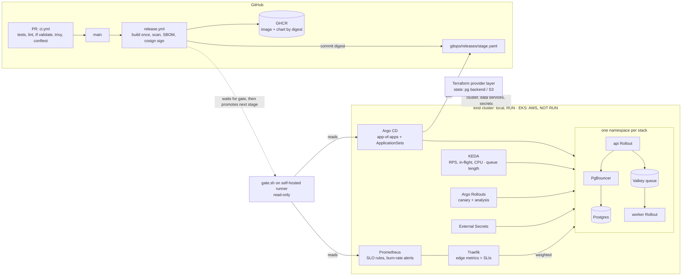

# Architecture

**Labels:** RUN-LOCAL (executed on kind) · RUN-LOCAL (stand-in) (executed against the stand-in app) · NOT RUN (written and statically validated) · DESCRIBED (design only). Detail lives in `decisions.md` (ADRs), `docs/capacity.md` and the evidence folders. For how each component works and where it lives, see [docs/architecture/](architecture/README.md).

## 1. Summary

One Helm chart deploys the black-box API and worker to every **stack**: dev, staging, the shared prod stack, and one stack per dedicated tenant. Infrastructure is split at a **provider contract**. Terraform delivers a cluster, Postgres + PgBouncer, Valkey and secrets per stack. Everything above the contract is identical on every cloud. Releases are **built once, signed and promoted by digest** through Git commits that Argo CD pulls. Each stage is a canary judged on edge metrics, followed by a read-only metric gate, and the fleet order is shared → ring 1 → ring 2.

## 2. Diagram



ASCII fallback:

```
 PR ─► ci.yml ──► main ─► release.yml: build once ─► trivy ─► SBOM ─► cosign ─► chart (OCI)
                                │ commits digest to gitops/releases/<stage>.yaml (git only, never kubectl)
                                ▼
   dev ─gate─► staging ─gate─► [human approval] ─► prod-ring0 (shared) ─gate─► ring1 (acme, EU) ─gate─► ring2 (globex)
 ┌───────────────────────────── cluster (kind locally · EKS on AWS) ─────────────────────────────┐
 │ Argo CD pulls ─► per-stack Application ─► Rollouts: api canary 10/25/50 (Traefik weights),    │
 │                  worker replica-weighted canary · background analysis on Prometheus           │
 │ Traefik ─► api-stable / api-canary ─► API ─► PgBouncer (txn) ─► Postgres   API ─► Valkey ─► worker │
 │ KEDA: API on edge RPS + in-flight + CPU; worker on list length · ESO ◄─ OpenBao / Secrets Manager │
 └────────────────────────────────────────────────────────────────────────────────────────────┘
   Terraform (provider layer) creates the cluster and each stack's data services and secrets
```

## 3. Layers

| Layer | Owns | Tool | Differs per provider? |
|---|---|---|---|
| **Provider** | cluster, network, Postgres + PgBouncer, Valkey, secrets store, state backend, backup volume | Terraform (`infra/modules/{local,aws}`) | **Yes, the only layer that does** |
| **Platform** | ingress, GitOps, progressive delivery, autoscaling, secrets sync, observability | Argo CD apps (Helm), `gitops/platform` | values overlays only (`values/local`, `values/aws`) |
| **App** | API + worker per stack, SLO rules, backups, network policy | one chart, `charts/app` | no |

**The contract** (ADR-003): per stack, a PgBouncer endpoint `pgbouncer.<ns>.svc:5432` in transaction mode, a Valkey endpoint, and a secret at `stacks/<stack>/app` holding `DATABASE_URL` (via PgBouncer), `MIGRATION_DATABASE_URL` (direct, for advisory locks) and `REDIS_URL`. Plus a cluster and a locked remote state. `infra/live/local/20-data/tests/contract_test.sh` checks it for every stack. The AWS implementation delivers the same contract with EKS, RDS, ElastiCache and Secrets Manager (NOT RUN). `docs/non-portable.md` lists what doesn't port.

## 4. Flows

**Release (RUN-LOCAL).**
1. A merge under `app/` or `charts/` triggers `release.yml`. It builds the image once, pushes it by digest, scans it (Trivy, failing on fixable HIGH/CRITICAL), attests a CycloneDX SBOM and signs it with keyless cosign. The chart is packaged as `0.1.<run>` and pushed to the OCI registry.
2. Promotion is a commit: `bump-release.sh` writes the chart version and image digest into `gitops/releases/<stage>.yaml`, using a deploy key the ruleset lets bypass.
3. Argo CD pulls the change. The PreSync hook takes a `pg_dump`. The API canary moves 10 → 25 → 50% with background analysis (success ≥ 99%, p95 ≤ 400 ms, ≥ 20 req/min).
4. `gate.sh` (on a self-hosted runner, read-only) waits for Synced/Healthy at the expected version, checks the exact digest is running, soaks for 3 minutes, checks the 5xx ratio < 0.5%, p95 < 400 ms and queue age < 120 s, and only then lets the next stage start.
5. Prod needs a reviewer. A failure anywhere halts every later stage (evidence 02).

**Request and job path.**
- **Requests:** Traefik → weighted `TraefikService` → `api-stable` / `api-canary` → API → PgBouncer → Postgres.
- **Jobs:** `POST /api/jobs` → Valkey list. Workers claim jobs with `BLMOVE` into a per-worker processing list and heartbeat while they work. A reaper requeues the jobs of dead workers. Delivery is at-least-once (ADR-006).
- **Shutdown:** the pod is marked Terminating and removal from endpoints begins → the kubelet runs the preStop sleep (5 s, so Traefik stops routing first) → SIGTERM → the app fails `/readyz` and drains in-flight work → exit. API grace is 30 s; workers get 90 s, more than the 60 s maximum job.

**Scaling** (ADR-013). The API scales on the **maximum** of three triggers:
- edge req/s per pod (target 126 in prod = 70% of the measured capacity of ~180), for steady state;
- **requests in flight per pod** (5.6), which still grows when demand outruns capacity;
- CPU, as a safety net set to fire after the request-rate trigger.

The worker scales on Valkey list length. Evidence 03 explains why in-flight was added, and why the headroom rule (spare capacity ≥ ramp slope × reaction time) is the next change.

**Tenant onboarding.**
1. One reviewed PR adds `tenants/<name>.yaml`. CI runs conftest: the schema, and EU residency limited to EU member-state regions.
2. **Shared** tenants get a host route plus per-tenant SLO rules on the prod stack. **Dedicated** tenants get data services from Terraform `20-data`, then a stack Application from the ApplicationSet at their ring's release.
3. The Terraform apply is manual today. `tenant-apply.yml` and a timed onboarding run are DESCRIBED (roadmap).

## 5. The five decisions that shape everything

| # | Decision | Why | Rejected alternatives |
|---|---|---|---|
| 1 | **Three layers with a provider contract** ([ADR-003](../decisions.md)) | Portability is a property of one boundary that can be tested, not of every file. A second cloud means one new `modules/<provider>` set, and the platform and app layers don't change. | *One Terraform tree per cloud:* the divergence is invisible until it breaks. *Crossplane:* another control plane to run, and harder to explain in review. *Lowest-common-denominator managed services:* gives up RDS/ElastiCache HA. |
| 2 | **GitOps pull with Argo CD**, app-of-apps + ApplicationSets ([ADR-010](../decisions.md)) | The cluster pulls, so CI never holds cluster credentials. Drift is self-healed. One tenant YAML drives both Terraform and Argo CD. | *Pipeline push (`kubectl`/`helm` from CI):* cluster-admin credentials in CI and no drift correction. *Flux:* equivalent, but weaker UI and app-of-apps story for reviewers. |
| 3 | **API canary with Argo Rollouts + Traefik weights, judged on edge metrics** ([ADR-011](../decisions.md)); the worker uses a replica-weighted canary (ADR-012) | Real traffic to 10% first. Analysis uses Traefik's view, so the black box needs no instrumentation. A bad release is aborted automatically (evidence 02: 2 minutes, 10% of dev traffic). | *Blue/green:* doubles capacity and has no gradual signal; a migration hits all traffic at once. *Rolling update:* no traffic control, and rollback is just another rollout. *Flagger:* fine, but Rollouts' UI and analysis CRDs are easier to show. |
| 4 | **Promotion by digest through release-file commits, gated by read-only checks on a self-hosted runner** ([ADR-015](../decisions.md)) | The artifact tested in dev is byte-identical in prod (the digest is checked by the gate). Promotion is auditable as Git history. The runner only *reads*: it can't deploy. | *Kargo:* another controller for something release files already do. *Retagging images:* tags are mutable. *Gates inside Argo CD (PostSync hooks):* would block syncs, not promotions. |
| 5 | **Expand/contract migrations, a PreSync backup, and fix-forward after a migration** ([ADR-018](../decisions.md)) | The black box migrates at startup, so the canary's first pod changes the shared schema. N-1 compatibility makes image rollback safe (evidence 02: the old version ran on the expanded schema). The PreSync dump guarantees a restore point (evidence 04). | *Down-migrations:* rarely tested and often lossy. *A separate migration job:* needs an app change we can't assume. *Blue/green with a database copy:* doubles the database and needs write sync. |

## 6. Top five risks

| Risk | Impact | Mitigation now | Next step |
|---|---|---|---|
| **A single Postgres writer at 15x** (~2 queries/request → ~4,500 queries/s) | Writes don't scale out; the database becomes the ceiling | PgBouncer transaction pooling (40 server connections per instance); RDS `r7g.large` Multi-AZ; pool-wait metrics now scraped (evidence 01) | Load-test the real app's query mix; read replicas for reads; `r7g.xlarge` headroom; cache hot reads in Valkey |
| **A breaking migration ships despite the policy** | The stable version fails on the new schema; image rollback makes it worse | PreSync dump before every sync; [rollback-after-migration runbook](runbooks/rollback-after-migration.md); fix-forward | CI check that classifies migration SQL (DROP/RENAME/NOT NULL without default) and requires a two-release plan |
| **The black-box worker doesn't drain on SIGTERM** | Jobs killed mid-run, then duplicated by the reaper | 90 s grace (> 60 s max job); at-least-once queue with heartbeats and a reaper; the stand-in proves the contract | Confirm SIGTERM handling and idempotency with the app team; `preStop` hook to stop claiming |
| **Laptop evidence isn't representative** | Capacity and timing numbers may not transfer to AWS | Every result labelled; the 15x attempts and their limits reported as found (evidence 03); AWS sizing derived in `capacity.md` | First AWS apply, then the 15x test from a load generator outside the cluster; apply the headroom fix |
| **Promotion depends on GitHub** (Actions, GHCR, the self-hosted runner) | No releases during a GitHub outage (running workloads are unaffected) | Images pinned by digest, so nodes don't need GHCR to keep running; break-glass is a reviewed commit to the release file, which Argo CD applies without Actions | ECR pull-through cache; runbook for promotion during an outage; a second runner |

## 7. Built versus described

**Executed on the laptop (RUN-LOCAL):**
- the provider layer locally, the platform layer and the app chart;
- the full pipeline across 5 stages, including rings 1 and 2;
- canary, auto-rollback and gates;
- backups and the restore drill;
- SLO rules and alerts;
- the 15x attempts.

**Not run:** the AWS provider layer and platform overlays (NOT RUN). **Described only:** Kyverno signature verification at admission, the Terraform drift workflow, the tenant-onboarding workflow and its timing, per-tenant dashboards, and the change-request addendum. Item-by-item status: the README's coverage table.
