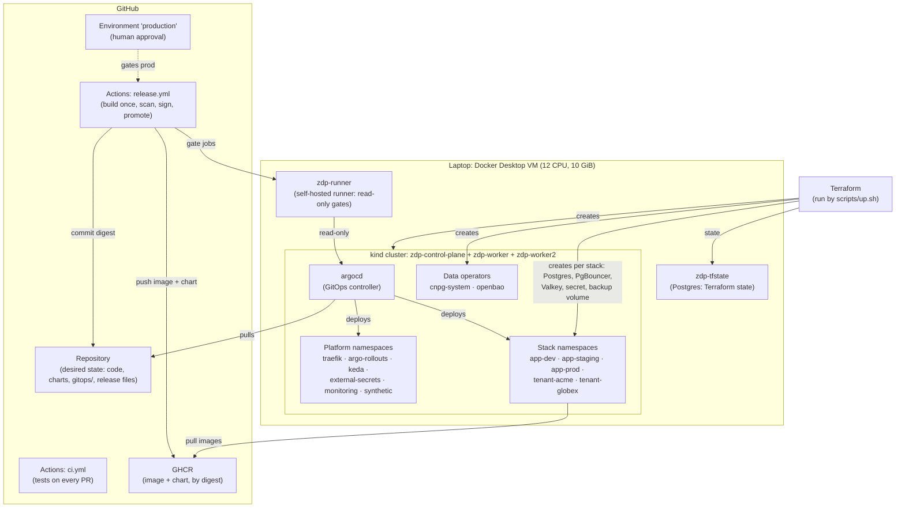

# How the platform works

**Label:** the local platform is RUN-LOCAL (every component below was running on kind when this was written); AWS equivalents are NOT RUN.

These pages explain the infrastructure piece by piece: **what each component is, where it runs, where it's defined, and why it's there.** They go deeper than [`docs/architecture.md`](../architecture.md), the 5-page summary for reviewers. The decisions behind each choice are in [`decisions.md`](../../decisions.md).

| Page | Answers |
|---|---|
| [components.md](components.md) | What is every component, where does it run, where is it defined, what is it for? |
| [where-things-live.md](where-things-live.md) | Which machine, container, namespace and repo folder holds what; where state, data, secrets and artifacts are kept; the provider contract |
| [flows.md](flows.md) | Step by step: a release, a request, a job, a scale-up, a secret, a backup, a shutdown |
| [tenancy.md](tenancy.md) | Shared vs dedicated tenants, onboarding, release rings, EU residency |

## The big picture

**Read it as three layers** (ADR-003):
1. **Provider layer:** Terraform builds the cluster and, for each stack, its data services and secret. This is the only layer that changes per cloud.
2. **Platform layer:** Argo CD installs the shared tooling from `gitops/`: ingress, progressive delivery, autoscaling, secrets sync, observability.
3. **App layer:** one Helm chart (`charts/app`) deploys the API and worker into each stack namespace, at the version pinned in that stage's release file.

**Read it as four planes:**

| Plane | Question | Main parts |
|---|---|---|
| Delivery | How does a code change reach users? | GitHub Actions → GHCR → release files → Argo CD → Argo Rollouts → gates ([flows: release](flows.md#1-a-release)) |
| Control | Who keeps the cluster matching Git? | Argo CD (self-heal), KEDA + HPA (replicas), Argo Rollouts (canary steps), External Secrets (secrets) |
| Data | Where is state kept? | Postgres (CNPG), Valkey, backup volumes, OpenBao, Terraform state, GHCR, Git ([where things live](where-things-live.md#state-data-secrets-and-artifacts)) |
| Observability | How do we know it's healthy? | Traefik edge metrics → Prometheus → SLO rules, burn-rate alerts, canary analysis, gates, autoscaling |

## Reading paths

- **"Where does X run, and why is it there?"** → [components.md](components.md)
- **"I want to change Y; which file?"** → [where-things-live.md](where-things-live.md#the-repository-what-is-applied-by-whom)
- **"What happens when I merge?"** → [flows.md](flows.md#1-a-release)
- **"How do I add a customer?"** → [tenancy.md](tenancy.md#onboarding-a-tenant)
- **"What differs on AWS?"** → [`docs/non-portable.md`](../non-portable.md)
