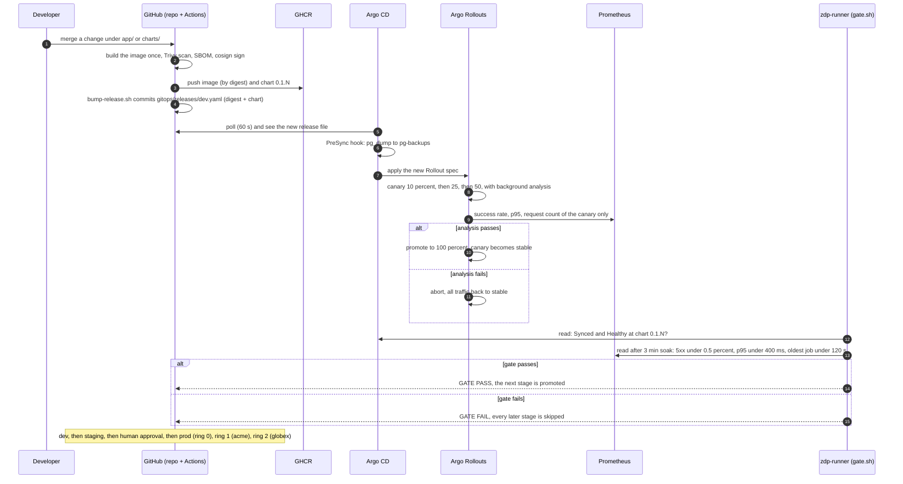
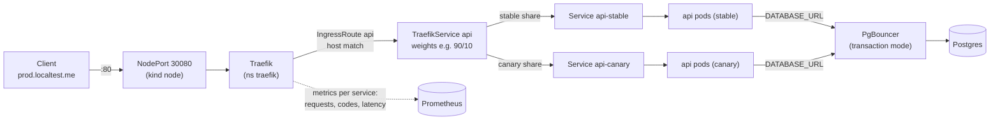
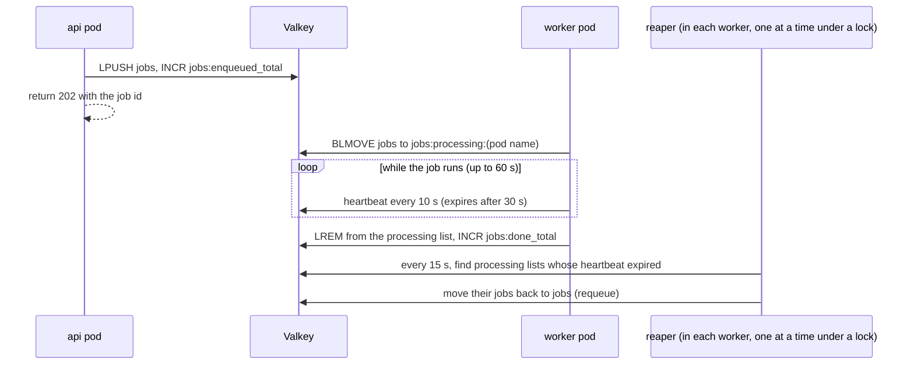
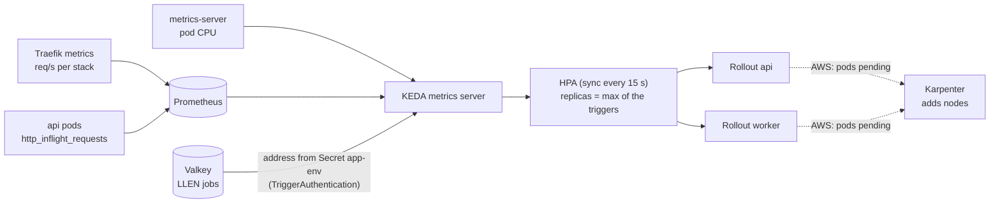
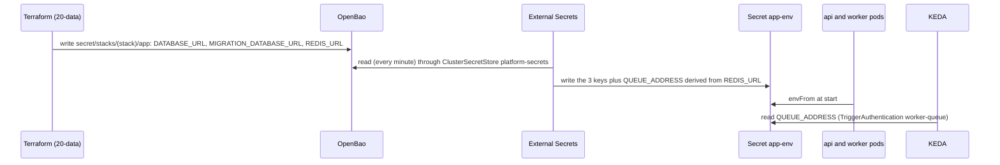
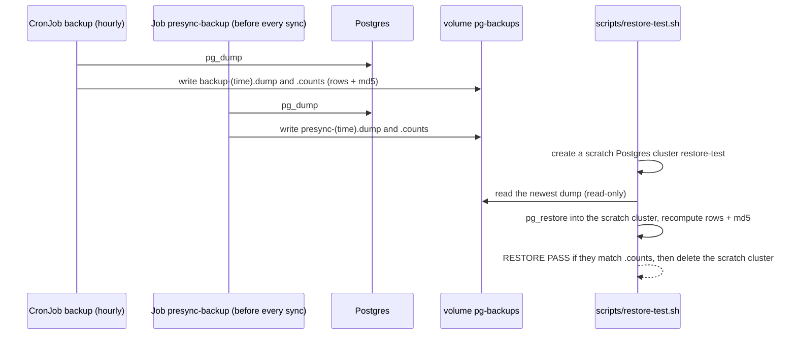
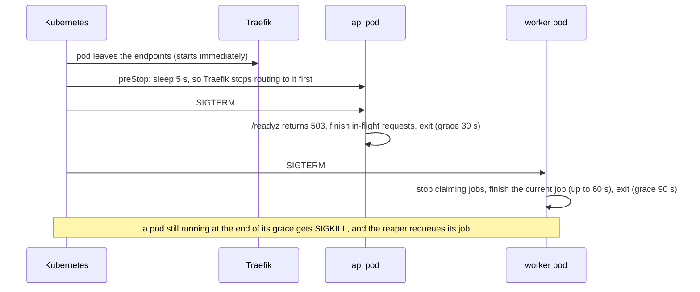

# How things flow

**Label:** RUN-LOCAL. Every flow below ran on the local platform (the evidence links show where), except the AWS notes, which are NOT RUN.

## 1. A release

From a merge on `main` to every stack running the new version. Evidence: `evidence/00-bringup`, `evidence/01-deploy-under-load`, `evidence/02-auto-rollback`.

**Key properties:**
- The cluster is never pushed to. CI writes Git, and Argo CD pulls.
- The digest checked by the gate is the digest built in step 2.
- A failure anywhere stops the fleet: evidence 02 shows a bad release aborted in dev, with every later stage skipped.

## 2. A request

- **Traefik's metrics are the source of truth.** The SLIs, the canary analysis, the promotion gate and the API autoscaler all read the same counters, measured where users enter. The app needs no instrumentation for any of them.
- **Each API pod serves at most 8 requests at once.** Extra requests queue inside the pod. That's the stand-in's capacity model: about 180 req/s per pod.

## 3. A job

- **Delivery is at least once.** A worker killed mid-job never loses it: the reaper requeues it.
- **Jobs must be idempotent.** A job can run twice, and so can a client retry after a timeout (evidence 03).
- **The accounting invariant** `enqueued_total == done_total + failed_total` held in every load test.

## 4. A scale-up

| Trigger | Target | Role |
|---|---|---|
| API req/s per pod | 126 (70% of the measured capacity) | steady-state sizing |
| API requests in flight per pod | 5.6 (70% of the limit of 8) | reacts to saturation, where req/s stops growing |
| API CPU | 100% of 200m | safety net: fires after the others |
| Worker queue length per worker | 5 | job load |

- **Scale-up:** the larger of +100% and +8 pods every 15 s (3 → 11 → 21).
- **Scale-down:** after a 5-minute window, at most −20% per minute.
- **Evidence 03** shows why the in-flight trigger exists, and why the headroom rule is the next change.

## 5. A secret

On AWS, the store is Secrets Manager and External Secrets authenticates with Pod Identity. The ExternalSecret, the Secret and the chart are identical.

## 6. A backup and a restore drill

The drill is non-destructive and timed: RTO 34–43 s for the stand-in's data (evidence 04). Backup jobs time out after 15 minutes, so a hung job can't block the schedule, and `ZdpBackupStale` alerts if no backup has succeeded for 2 hours.

## 7. A shutdown (rollout, scale-in or node drain)

Evidence: `scripts/tests/image_smoke_test.sh` shows `docker stop` exiting cleanly (exit 0) in under 30 s. Evidence 01 shows a whole prod rollout under 150 req/s with zero failed requests.
