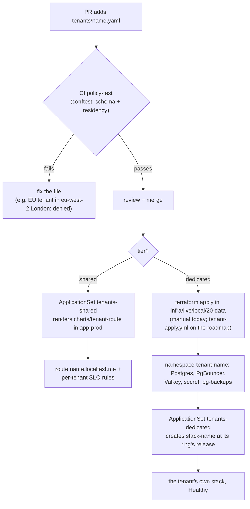
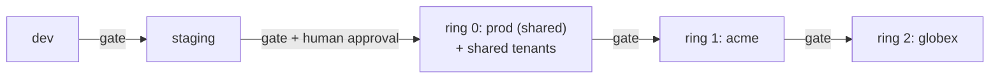

# Tenancy: shared and dedicated, onboarding, rings, residency

**Label:** RUN-LOCAL for the three tenants running on kind (initech shared; acme and globex dedicated; regions simulated); the AWS node pools and regions are NOT RUN. Onboarding time is not yet measured (roadmap item 7).

## Two tiers from one template

| | **Shared** (e.g. `initech`) | **Dedicated** (e.g. `acme`, `globex`) |
|---|---|---|
| Runs on | the shared prod stack, `app-prod` | its own stack namespace, `tenant-<name>` |
| App | the shared API and worker | its own API and worker, same chart |
| Database, queue, secret | shared with prod | its own Postgres, PgBouncer, Valkey and secret |
| Compute | shared nodes | shared nodes locally; on AWS its own tainted node pool (`NodePool tenant-<name>`) |
| Network | prod's policies | default-deny, its own namespace |
| Visibility | its own Traefik router, so its own request, error and latency metrics on the shared stack | everything is per tenant: it's its own namespace |
| SLO | 99.9% | 99.95% (from the tenant file) |
| Gets a new release | with prod, in **ring 0** | in **its ring** (1 or 2), after prod has passed its gate |
| Cost (AWS estimate) | a share of prod | about $840/month steady ([cost.md](../cost.md)) |
| Defined by | `charts/tenant-route` (route + SLO rules) | `charts/app` + Terraform `stack-data` |

## Onboarding a tenant

One reviewed pull request adds one file. For example, `tenants/acme.yaml`:

```yaml
name: acme
tier: dedicated
residency: eu
region: eu-central-1
ring: 1
size: small
slo: "99.95"
```



**One file drives both systems:** Terraform reads `tenants/*.yaml` to create the data services, and Argo CD's ApplicationSets read the same files to create the apps. A tenant can't be validated against one region and deployed to another.

If onboarding gets stuck, see [failed-tenant-onboarding](../runbooks/failed-tenant-onboarding.md).

## Release rings: who gets a new version when



- **Rollout order:** the shared stack goes first, because its traffic gives the most signal, then dedicated tenants ring by ring. A tenant's `ring` field places it.
- **Halt on failure:** a failed gate skips every later ring (evidence 02).
- **Regions:** locally they are labels. On AWS, each region has its own cluster and only tenants homed there are deployed to it, via the ApplicationSets' `region` post-selector.

## EU data stays in the EU

| Layer | How it's enforced |
|---|---|
| **Merge time** | `policy/tenants.rego`: a tenant with `residency: eu` must name an EU member-state region. London (`eu-west-2`) and Zurich (`eu-central-2`) start with "eu-" but are denied, with a test for each. Evidence: `evidence/00-ci` |
| **Apply time** | Terraform and Argo CD take the region from the same validated file |
| **On AWS** (NOT RUN) | each regional cluster only receives tenants homed in its region; backups are replicated within the EU (eu-central-1 → eu-west-1); a permissions boundary or SCP denies non-EU regions (`docs/policies/eu-region-scp.json`) |
